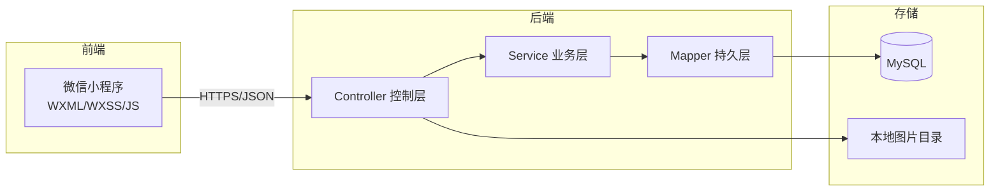
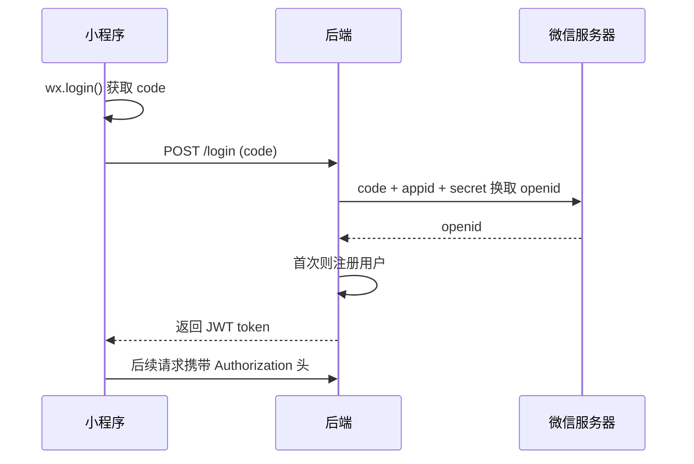
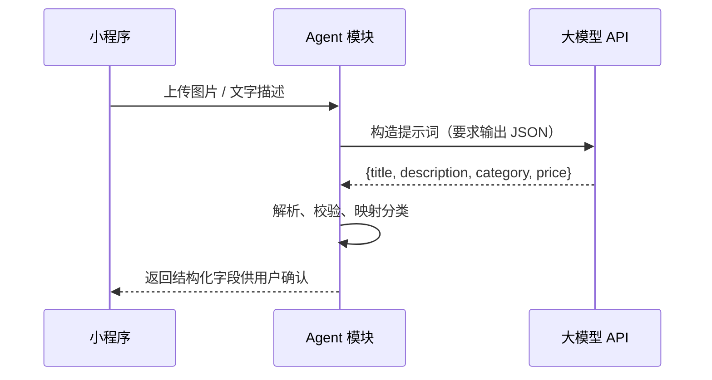

# 校园二手交易平台（YouBinCampus）技术选型与架构设计

> 版本：v1.1
> 日期：2026-10-08
> 定位：微信小程序 + Java/Spring 后端 + AI Agent，课程大作业演示

---

## 1. 技术选型总览

| 层 | 选型 | 版本建议 | 说明 |
|---|---|---|---|
| 前端 | 微信原生小程序 | 基础库 3.x | WXML/WXSS/JavaScript |
| 后端框架 | Spring Boot | 4.x（JDK 21） | 当前主流稳定版；如遇 MyBatis-Plus 兼容问题可降 3.3.x |
| 持久层 | MyBatis-Plus | 3.5.x | 用 `mybatis-plus-spring-boot3-starter` |
| 数据库 | MySQL | 8.x | 最通用、课程熟悉 |
| 登录鉴权 | 微信登录 + JWT | — | 演示可降级为「模拟登录」 |
| 图片存储 | 本地磁盘静态映射 | — | 演示零成本 |
| 接口文档 | Knife4j | 4.x | 可视化、便于联调与答辩 |
| AI Agent | 大模型 API（DeepSeek/通义千问/GLM） | — | 智能发布、自然语言搜索 |
| 部署 | 本机 + 内网穿透（cpolar/natapp） | — | 小程序真机访问本地后端 |

---

## 2. 选型理由

### 2.1 为什么选微信小程序（而非 Web/App）

- 校园场景天然贴合，用户无需下载安装；
- 微信登录 + 拍照上图体验好；
- 官方文档完善，前端学习成本低；
- 便于答辩现场真机演示。

### 2.2 为什么选 Spring Boot + MyBatis-Plus

- Java/Spring 是多数课程的必修技术栈，团队熟悉度高；
- Spring Boot 生态成熟、自动配置，适合快速搭建 REST 接口；
- MyBatis-Plus 的内置通用 Mapper 可免写大量单表增删改查，聚焦业务逻辑。

### 2.3 为什么「后端用本地磁盘存图片」（演示阶段）

- 零外部依赖、零费用；
- 演示环境数据量小，性能无压力；
- 通过 `WebMvcConfigurer` 将本地目录映射为静态资源 URL 直接返回给前端。

> 上线需替换为腾讯云 COS / 阿里云 OSS，并接入微信支付，此点作为「扩展演进」而非 MVP 内容。

---

## 3. 系统总体架构



分层职责：

| 层 | 职责 |
|---|---|
| Controller | 接收请求、参数校验、封装统一响应 |
| Service | 业务逻辑、事务控制、鉴权校验 |
| Mapper | 数据访问（MyBatis-Plus） |

---

## 4. 模块划分

### 4.1 后端模块

| 模块 | 包名 | 职责 |
|---|---|---|
| 通用 | common | 统一返回体、全局异常、常量 |
| 配置 | config | 拦截器、跨域、静态资源映射、Swagger 配置 |
| 用户 | user | 登录、鉴权、个人信息 |
| 商品 | goods | 商品 CRUD、分类、搜索 |
| 分类 | category | 分类管理 |
| 收藏 | favorite | 收藏关系（可选） |
| Agent 智能 | agent | 大模型调用、智能发布助手、自然语言搜索 |

### 4.2 小程序页面

| 页面 | 说明 |
|---|---|
| pages/index | 首页商品列表 |
| pages/publish | 发布/编辑商品 |
| pages/detail | 商品详情 |
| pages/search | 搜索 |
| pages/mine | 个人中心 |
| pages/my-goods | 我发布的商品 |

---

## 5. 数据库设计（建表 SQL）

```sql
-- 用户表
CREATE TABLE `user` (
  `id`          BIGINT       NOT NULL AUTO_INCREMENT COMMENT '用户ID',
  `openid`      VARCHAR(64)  DEFAULT NULL COMMENT '微信openid（模拟登录为空）',
  `nickname`    VARCHAR(64)  NOT NULL COMMENT '昵称',
  `avatar`      VARCHAR(255) DEFAULT NULL COMMENT '头像URL',
  `phone`       VARCHAR(20)  DEFAULT NULL COMMENT '联系方式',
  `create_time` DATETIME     DEFAULT CURRENT_TIMESTAMP COMMENT '创建时间',
  PRIMARY KEY (`id`),
  UNIQUE KEY `uk_openid` (`openid`)
) ENGINE=InnoDB DEFAULT CHARSET=utf8mb4 COMMENT='用户表';

-- 分类表
CREATE TABLE `category` (
  `id`   BIGINT      NOT NULL AUTO_INCREMENT COMMENT '分类ID',
  `name` VARCHAR(32) NOT NULL COMMENT '分类名称',
  `sort` INT         DEFAULT 0 COMMENT '排序',
  PRIMARY KEY (`id`)
) ENGINE=InnoDB DEFAULT CHARSET=utf8mb4 COMMENT='商品分类表';

-- 商品表
CREATE TABLE `goods` (
  `id`          BIGINT         NOT NULL AUTO_INCREMENT COMMENT '商品ID',
  `user_id`     BIGINT         NOT NULL COMMENT '发布者ID',
  `category_id` BIGINT         NOT NULL COMMENT '分类ID',
  `title`       VARCHAR(128)   NOT NULL COMMENT '标题',
  `description` TEXT           COMMENT '描述',
  `price`       DECIMAL(10,2)  NOT NULL COMMENT '价格',
  `images`      JSON           COMMENT '图片URL数组',
  `status`      TINYINT        NOT NULL DEFAULT 1 COMMENT '状态：0下架 1在售 2已售',
  `create_time` DATETIME       DEFAULT CURRENT_TIMESTAMP COMMENT '发布时间',
  `update_time` DATETIME       DEFAULT CURRENT_TIMESTAMP ON UPDATE CURRENT_TIMESTAMP COMMENT '更新时间',
  PRIMARY KEY (`id`),
  KEY `idx_user` (`user_id`),
  KEY `idx_category` (`category_id`),
  KEY `idx_status_time` (`status`, `create_time`)
) ENGINE=InnoDB DEFAULT CHARSET=utf8mb4 COMMENT='商品表';

-- 收藏表（可选）
CREATE TABLE `favorite` (
  `id`          BIGINT   NOT NULL AUTO_INCREMENT COMMENT '收藏ID',
  `user_id`     BIGINT   NOT NULL COMMENT '用户ID',
  `goods_id`    BIGINT   NOT NULL COMMENT '商品ID',
  `create_time` DATETIME DEFAULT CURRENT_TIMESTAMP COMMENT '收藏时间',
  PRIMARY KEY (`id`),
  UNIQUE KEY `uk_user_goods` (`user_id`, `goods_id`)
) ENGINE=InnoDB DEFAULT CHARSET=utf8mb4 COMMENT='收藏表';
```

---

## 6. 接口设计约定

### 6.1 统一返回体

```json
{
  "code": 200,
  "message": "success",
  "data": {}
}
```

约定：`200` 成功；`401` 未登录；`403` 无权限；`400` 参数错误；`500` 服务异常。

### 6.2 核心接口清单

| 方法 | 路径 | 说明 |
|---|---|---|
| POST | /api/user/login | 登录（微信/模拟） |
| GET | /api/user/info | 当前用户信息 |
| GET | /api/goods/page | 分页列表（含分类/关键词/排序） |
| GET | /api/goods/{id} | 商品详情 |
| POST | /api/goods | 发布商品 |
| PUT | /api/goods/{id} | 编辑商品 |
| DELETE | /api/goods/{id} | 删除商品 |
| PUT | /api/goods/{id}/sold | 标记已售 |
| GET | /api/category/list | 分类列表 |
| POST | /api/upload/image | 上传图片 |
| POST | /api/agent/generate-goods | 智能发布：图片/文字 → 商品字段 |
| POST | /api/agent/search | 自然语言搜索：需求 → 商品列表 |

---

## 7. 登录鉴权方案



- **正式登录**：后端调微信接口换 openid，签发 JWT，前端存入本地，请求头携带。
- **模拟登录（演示兜底）**：未配置 AppID 时，前端直接传学号/昵称，后端生成用户并签发 JWT，保证演示不因微信资质卡壳。

---

## 8. 图片存储方案

- 小程序端用 `wx.chooseMedia` 选图 → `wx.uploadFile` 上传；
- 后端保存至本地目录（如 `upload/`），重命名为 `uuid.jpg` 防冲突；
- 通过静态资源映射将 `/images/**` 映射到本地目录；
- 返回完整可访问 URL 存入商品 `images` 字段。

---

## 9. AI Agent 功能技术方案

### 9.1 整体思路

后端新增 `agent` 模块，封装对大模型 API 的调用。通过**提示词工程**约束模型输出**结构化 JSON**，后端解析后映射为商品字段或检索条件，无需自建模型。

### 9.2 模型选型

| 项 | 推荐 | 说明 |
|---|---|---|
| 文本模型 | DeepSeek / 通义千问 / GLM | 国内可直连、便宜、免翻墙 |
| 多模态（图片识别） | 通义千问 VL / DeepSeek-VL | 识别商品图片生成描述；文本兜底 |
| 接入方式 | HTTP 调用官方 API | 后端封装统一 `LLMClient` 与超时/重试 |

### 9.3 智能发布助手实现



- **提示词约束**：明确要求返回固定 JSON 键（`title` / `description` / `category` / `price`），价格用数字；
- **容错**：模型返回非标准 JSON 时做解析兜底或重试；
- **复用**：生成结果直接填充发布表单，用户确认后才入库。

### 9.4 自然语言搜索实现

- 用户输入自然语言 → Agent 调 LLM 输出结构化条件（关键词、分类、价格区间）；
- 后端将条件转成现有 `GET /api/goods/page` 的查询参数，**复用列表接口**，无需单独向量数据库，降低实现成本。

---

## 10. 部署与演示方案

| 方案 | 说明 |
|---|---|
| 本机运行 | 后端 `mvn spring-boot:run`，MySQL 本机或 Docker |
| 真机演示 | 内网穿透（cpolar/natapp）暴露后端 HTTPS 地址，小程序配置合法域名 |
| 简化演示 | 使用微信开发者工具「不校验合法域名」，HTTP 直连本机 |

---

## 11. 风险与应对

| 风险 | 影响 | 应对 |
|---|---|---|
| JDK 版本与学校环境不一致 | 项目无法编译 | 已定 JDK 21 → Spring Boot 4.x；如遇生态兼容问题可降 3.3.x |
| 小程序需正式 AppID 才能发布 | 无法真机演示 | 使用测试号 / 模拟登录兜底 / 开发者工具演示 |
| 图片上传无外部存储 | 演示局限 | 本地磁盘存储足够 MVP，上线再迁移 COS |
| 前后端联调接口不一致 | 进度受阻 | 用 Knife4j 统一接口文档，先定契约再并行开发 |
| 大模型 API 不稳定/限流 | Agent 功能偶发失败 | 封装统一 `LLMClient`，加超时重试与失败降级提示 |

---

## 12. 后续演进方向（非 MVP）

- 图片迁移至腾讯云 COS / 阿里云 OSS；
- 接入微信支付，实现在线担保交易；
- 站内即时消息（WebSocket）；
- 商品审核与违规举报机制；
- 基于浏览/收藏的商品推荐；
- Agent 增强：接入向量检索、多轮对话式导购。