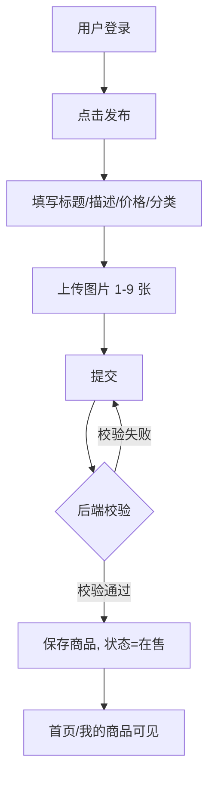
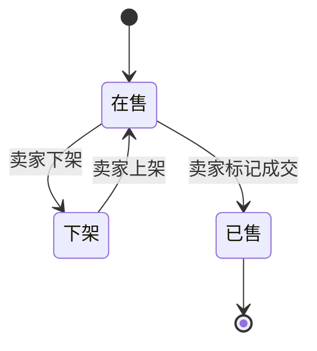
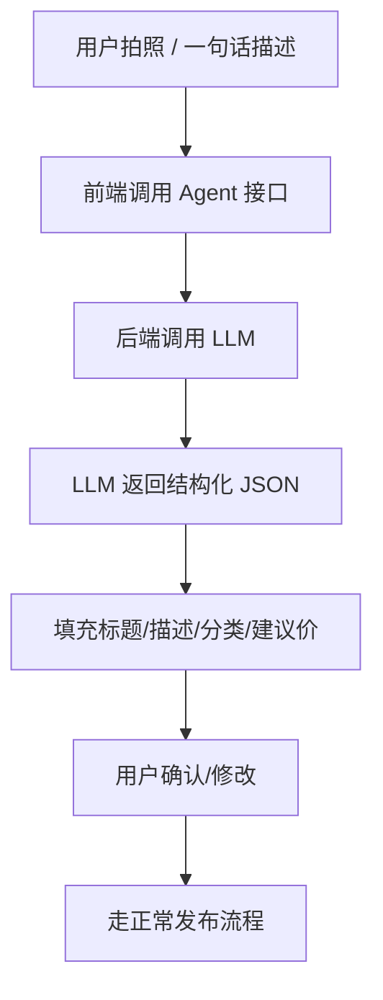
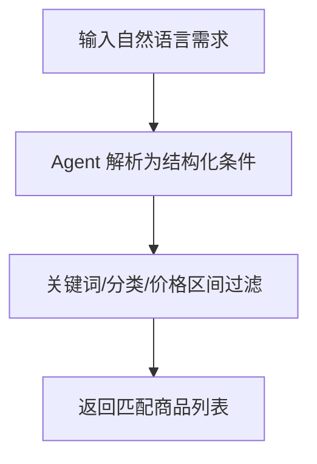
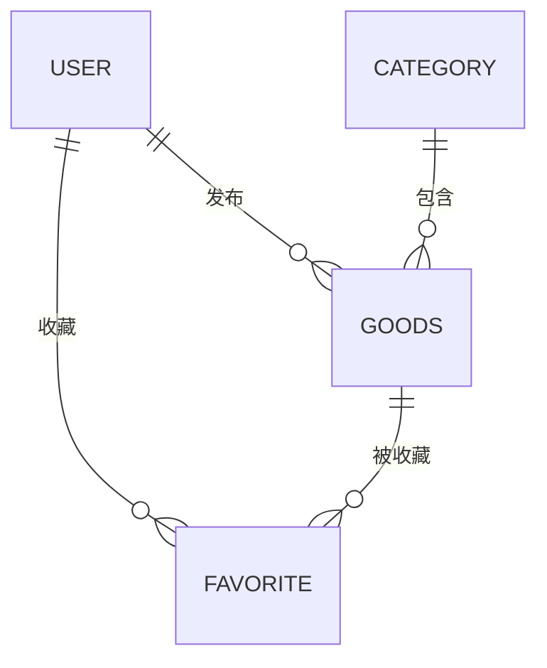

# 校园二手交易平台（YouBinCampus）需求规格说明书

> 版本：v1.1
> 日期：2026-10-08
> 项目定位：课程大作业演示

---

## 1. 引言

### 1.1 编写目的

本文档用于明确「校园二手交易平台（YouBinCampus）」的功能需求、业务流程、数据需求与非功能需求，作为后续系统设计、开发、测试与验收的统一依据。

### 1.2 项目背景

高校学生在毕业季、换学期、搬宿舍等场景中存在大量闲置物品（教材、电子产品、生活用品、体育器材等）交易需求。传统的群聊、贴吧交易方式存在信息杂乱、难以检索、无法沉淀、缺乏信任机制等问题。本平台旨在为校园内学生提供一个**轻量、可信、易用**的二手物品交易渠道。

### 1.3 术语定义

| 术语 | 说明 |
|---|---|
| 商品（Goods） | 用户发布的闲置物品信息，含标题、描述、价格、图片等 |
| 在售 / 已售 / 下架 | 商品生命周期中的三种状态 |
| openid | 微信用户在本小程序内的唯一标识 |
| MVP | 最小可行产品，指本次演示必须完成的核心功能集 |
| COS | 腾讯云对象存储 |
| Agent | 基于大模型的智能体，能自主完成发布辅助、自然语言搜索等任务 |
| LLM | 大语言模型，Agent 的底层能力来源 |

### 1.4 参考资料

- 《软件工程——实践者的研究方法》
- 微信小程序官方开发文档
- 课程大作业任务书

---

## 2. 项目概述

### 2.1 产品定位

基于**微信小程序**的校园二手物品交易平台，服务于单一高校（或高校群体）内的在校学生。

### 2.2 目标用户

| 用户类型 | 特征 | 核心诉求 |
|---|---|---|
| 卖家（学生） | 有闲置物品需要处理 | 快速发布、便捷成交 |
| 买家（学生） | 想低价淘到所需物品 | 快速检索、可信交易 |
| 管理员 | 平台运维人员 | 内容审核、违规治理（可选） |

### 2.3 项目目标

- 提供商品发布、浏览、搜索、交易的状态闭环；
- 以微信登录降低使用门槛；
- 完整演示「发布 → 浏览 → 交易 → 状态流转」的核心流程；
- 作为《软件项目管理》课程的完整实践项目。

---

## 3. 用户角色与权限

| 角色 | 权限 |
|---|---|
| 普通用户 | 登录、发布/编辑/下架/删除商品、浏览/搜索/收藏商品、发起/完成交易、管理个人中心 |
| 管理员（扩展） | 商品审核、违规商品下架、分类管理、用户管理 |

> 本次演示聚焦「普通用户」角色，管理员作为扩展项。

---

## 4. 功能需求

### 4.1 用户模块

| 编号 | 功能 | 描述 | 优先级 |
|---|---|---|---|
| U-01 | 微信登录 | 通过 `wx.login` 获取用户身份，首次登录自动注册 | 高 |
| U-02 | 模拟登录（演示兜底） | 未配置小程序 AppID 时，允许以「学号/昵称」模拟登录 | 高 |
| U-03 | 查看/编辑个人信息 | 修改昵称、头像、联系方式 | 中 |

### 4.2 商品模块

| 编号 | 功能 | 描述 | 优先级 |
|---|---|---|---|
| G-01 | 发布商品 | 填写标题、描述、价格、分类，上传 1~9 张图片 | 高 |
| G-02 | 编辑商品 | 修改已发布商品的各项信息 | 高 |
| G-03 | 下架商品 | 商品暂时不可见，可重新上架 | 高 |
| G-04 | 删除商品 | 彻底移除商品 | 中 |
| G-05 | 商品状态流转 | 在售 → 已售（或下架） | 高 |

### 4.3 浏览与搜索模块

| 编号 | 功能 | 描述 | 优先级 |
|---|---|---|---|
| B-01 | 商品列表 | 首页按发布时间倒序展示商品（分页加载） | 高 |
| B-02 | 分类筛选 | 按商品分类（教材、数码、生活、体育、其他）过滤 | 高 |
| B-03 | 关键词搜索 | 按标题/描述模糊搜索 | 高 |
| B-04 | 商品详情 | 展示图片、描述、价格、卖家信息 | 高 |
| B-05 | 商品排序 | 按价格 / 发布时间排序 | 中 |

### 4.4 交易模块

| 编号 | 功能 | 描述 | 优先级 |
|---|---|---|---|
| T-01 | 收藏商品 | 收藏心仪商品 | 中 |
| T-02 | 「想要」标记 | 买家对商品表达购买意向 | 中 |
| T-03 | 标记成交 | 卖家将商品标记为「已售」 | 高 |
| T-04 | 联系卖家 | 展示卖家联系方式或发起站内消息（可选） | 中 |

### 4.5 个人中心模块

| 编号 | 功能 | 描述 | 优先级 |
|---|---|---|---|
| P-01 | 我发布的 | 查看/管理自己发布的商品 | 高 |
| P-02 | 我收藏的 | 查看收藏列表 | 中 |
| P-03 | 我买到的 | 查看已成交的购买记录 | 中 |

### 4.6 Agent 智能功能模块

| 编号 | 功能 | 描述 | 优先级 |
|---|---|---|---|
| A-01 | 智能发布助手 | 用户拍照或一句话描述物品，Agent 自动生成标题、描述、分类与建议价格，可一键填充发布表单 | 高 |
| A-02 | 自然语言搜索 | 用户用自然语言描述需求（如「2000 内九成新 iPad」），Agent 解析为结构化条件并返回匹配商品 | 高 |

---

## 5. 核心业务流程

### 5.1 发布商品流程

### 5.2 商品状态流转

### 5.3 购买流程（用户视角）

### 5.4 智能发布 Agent 流程

### 5.5 自然语言搜索流程

---

## 6. 数据需求

### 6.1 实体关系（ER 概要）

- 一个用户可发布多条商品（1 : N）；
- 一个分类下包含多条商品（1 : N）；
- 用户与商品之间存在「收藏」关系（N : M），通过收藏表表达。

### 6.2 数据表设计（概要）

| 表名 | 用途 | 关键字段 |
|---|---|---|
| user | 用户信息 | id, openid, nickname, avatar, phone, create_time |
| category | 商品分类 | id, name, sort |
| goods | 商品信息 | id, user_id, category_id, title, description, price, images, status, create_time |
| favorite | 收藏关系 | id, user_id, goods_id, create_time |
| message（可选） | 站内消息 | id, from_user, to_user, goods_id, content, create_time |

---

## 7. 非功能需求

| 类别 | 需求描述 |
|---|---|
| 性能 | 商品列表分页加载，单页响应时间 ≤ 2s（演示环境） |
| 可用性 | 核心流程（发布→浏览→交易）无阻断性缺陷 |
| 安全性 | 用户身份鉴权（JWT）；越权操作校验（只能操作自己的商品） |
| 易用性 | 界面简洁，主要操作 3 步内可达 |
| 兼容性 | 适配主流手机尺寸的微信小程序 |
| 可维护性 | 前后端分离，接口规范统一，代码分层清晰 |

---

## 8. 需求优先级

### 8.1 MVP（必做，本次演示）

- U-01/U-02 登录、G-01 发布、G-03 下架、G-05 状态流转
- B-01 列表、B-02 分类、B-03 搜索、B-04 详情
- T-03 标记成交、P-01 我发布的
- A-01 智能发布助手、A-02 自然语言搜索（教师要求加入的 Agent 功能）

### 8.2 扩展（可选加分）

- 站内聊天、商品审核与举报、管理员后台、商品推荐、T-01 收藏（视进度）

---

## 9. 约束与假设

- **假设**：目标用户集中在单一校园，物流以线下当面交易为主，平台不涉及在线支付。
- **约束**：演示阶段图片存储使用本地磁盘；真实上线需迁移至对象存储并接入微信支付。
- **约束**：小程序需通过微信审核获得正式 AppID；开发阶段可使用测试号。

---

## 附录 A：功能实现状态对照表

> 说明：本表依据后端现有接口（截至 2026-10-18）与《开发过程记录 docs/develop.log》整理，仅用于验收对照；状态以接口可用性为准，前端交互细节以微信开发者工具实测为准。

| 编号 | 功能 | 状态 | 对应接口 |
|---|---|---|---|
| U-01 | 微信登录 | 已实现 | POST /api/user/login |
| U-02 | 模拟登录（演示兜底） | 已实现 | POST /api/user/login（同一接口，支持昵称模拟） |
| U-03 | 查看/编辑个人信息 | 部分实现 | 查看：GET /api/user/info；编辑接口未见 |
| G-01 | 发布商品 | 已实现 | POST /api/goods |
| G-02 | 编辑商品 | 已实现 | PUT /api/goods/{id} |
| G-03 | 下架商品 | 已实现 | PUT /api/goods/{id}/offline、PUT /api/goods/{id}/online |
| G-04 | 删除商品 | 已实现 | DELETE /api/goods/{id} |
| G-05 | 商品状态流转 | 已实现 | PUT /api/goods/{id}/sold、/offline、/online |
| B-01 | 商品列表 | 已实现 | GET /api/goods/page |
| B-02 | 分类筛选 | 已实现 | GET /api/goods/page?categoryId=；GET /api/category/list |
| B-03 | 关键词搜索 | 已实现 | GET /api/goods/page?keyword= |
| B-04 | 商品详情 | 已实现 | GET /api/goods/{id}（响应含 wantCount） |
| B-05 | 商品排序 | 已实现 | GET /api/goods/page?sort=price_asc / price_desc |
| T-01 | 收藏商品 | 已实现 | POST/DELETE /api/favorite/{goodsId}；GET /api/favorite/list |
| T-02 | 「想要」标记 | 已实现（记录 #002） | POST/DELETE /api/want/{goodsId}；GET /api/want/check/{goodsId}、/api/want/mine、/api/want/goods/{goodsId} |
| T-03 | 标记成交 | 已实现 | PUT /api/goods/{id}/sold |
| T-04 | 联系卖家 | 已实现（记录 #002，复用 message 表留痕） | GET /api/goods/{id}/contact；POST /api/contact/{goodsId}；GET /api/contact/goods/{goodsId} |
| P-01 | 我发布的 | 已实现 | GET /api/user/my-goods |
| P-02 | 我收藏的 | 已实现 | GET /api/favorite/list |
| P-03 | 我买到的 | 未实现 | 无对应接口（平台为线下交易，无订单表） |
| A-01 | 智能发布助手 | 已实现 | POST /api/agent/generate-goods |
| A-02 | 自然语言搜索 | 已实现 | POST /api/agent/search |

> 备注：T-02/T-04 为本轮（docs/develop.log 记录 #002）新增；T-04 复用库中既有 message 表承载联系留痕，本轮未新建 message 表。前端 5 条交互用例尚未在微信开发者工具运行时验证，详见 docs/develop.log 记录 #002 第四节。