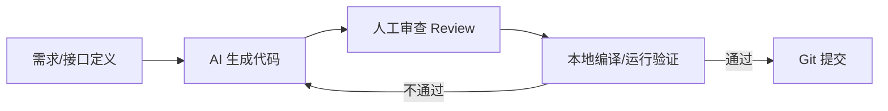
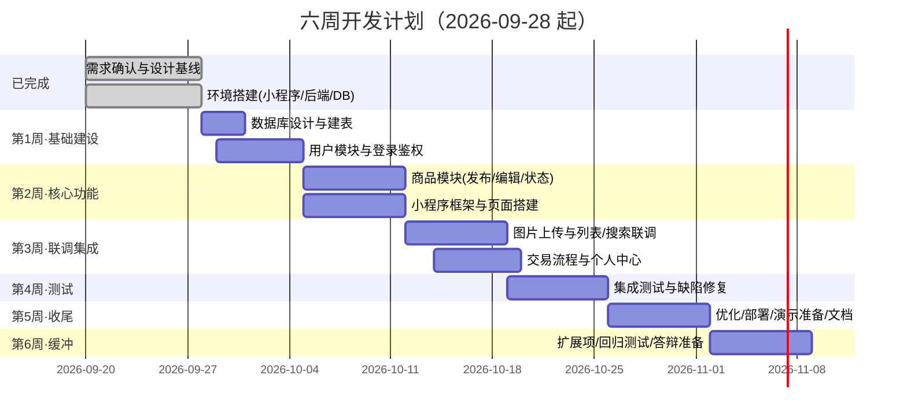
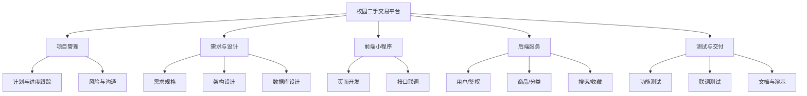

# 校园二手交易平台（YouBinCampus）项目计划书

> 版本：v1.1
> 日期：2026-09-27
> 开发周期：6 周（2026-09-28 起；需求与设计阶段已于 09-27 完成）
> 开发方式：AI 辅助编程（AI 生成代码 + 人工审查 + 自动化验证）

---

## 1. 项目概述

### 1.1 项目名称

校园二手交易平台（YouBinCampus）

### 1.2 项目背景

高校学生存在大量闲置物品交易需求，传统群聊/贴吧方式信息杂乱、难以检索、缺少沉淀。本项目基于微信小程序，为校园学生提供一个轻量、可信、易用的二手交易渠道。

### 1.3 项目目标

在 6 周内完成一个可演示的校园二手交易平台，覆盖「登录 → 发布 → 浏览/搜索 → 交易 → 状态流转」的核心闭环，作为《软件项目管理》课程的完整实践成果。

### 1.4 项目边界

| 维度 | 说明 |
|---|---|
| 终端 | 微信小程序（前端） |
| 后端 | Spring Boot + MyBatis-Plus |
| 数据库 | MySQL 8 |
| 登录 | 微信登录 + JWT（演示可降级为模拟登录） |
| 支付 | 不接入线上支付（线下当面交易） |
| 图片 | 本地磁盘存储（上线再迁 COS） |

---

## 2. 项目范围

### 2.1 MVP（6 周内必须完成）

- 用户模块：微信登录 / 模拟登录、个人信息
- 商品模块：发布、编辑、下架、删除、状态流转（在售/下架/已售）
- 浏览模块：商品列表、分类筛选、关键词搜索、商品详情
- 交易模块：标记成交、联系卖家
- 个人中心：我发布的、我收藏的（可选）

### 2.2 扩展项（时间充裕时追加）

- 站内聊天、商品审核与举报、管理员后台、商品推荐

---

## 3. 开发方式：AI 辅助编程工作流

本项目以 **AI 编程为核心生产力**，人工负责需求理解、方案决策、代码审查与质量把关。

### 3.1 单功能开发流程

### 3.2 关键规范

| 环节 | 规范 |
|---|---|
| 提示词 | 需求描述清晰，明确输入/输出/边界，附数据表与接口契约 |
| 上下文 | 让 AI 先读相关文档（需求、接口约定、建表语句）再生成 |
| 代码审查 | AI 生成的代码必须人工 Review，重点关注业务逻辑与边界 |
| 验证 | 每步生成后立即编译/运行，小步提交，避免堆叠错误 |
| 版本管理 | 每个功能独立分支，AI 生成代码单独 commit，便于回滚 |

### 3.3 AI 编程注意事项

- 不盲目信任 AI 输出，关键模块（鉴权、状态流转、转账相关逻辑）必须人工核验；
- 保持接口契约先行，前后端并行开发时以文档为准；
- 生成的代码统一走风格检查、去除无用样板。

---

## 4. 项目组织与分工

> 分工按「角色」划分，可根据实际团队人数合并或拆分。

| 角色 | 职责 |
|---|---|
| 项目负责人（PM） | 计划制定、进度跟踪、里程碑把控、汇报 |
| 前端（小程序） | 页面开发、接口联调、用户体验 |
| 后端（Java） | 接口开发、数据库、鉴权、业务逻辑 |
| 测试 | 功能测试、联调测试、缺陷跟踪 |
| 文档 | 需求、设计、计划、测试文档维护 |

---

## 5. 进度计划（6 周）

### 5.1 甘特图

### 5.2 里程碑

| 里程碑 | 时间 | 交付物 | 完成标准 |
|---|---|---|---|
| M0 需求与设计基线 | 已完成（09-27） | 需求、设计、计划文档 | ✅ 已交付 |
| M1 后端可运行 + 登录打通 | 第 1 周末（10-04） | 可启动后端、数据库、登录接口 | 后端可编译运行，登录返回 JWT |
| M2 核心功能可用 | 第 2 周末（10-11） | 商品 + 列表/搜索功能 | 发布→浏览→详情流程可跑通 |
| M3 全流程联调通过 | 第 4 周末（10-25） | 前后端集成版本 | 核心闭环全流程无明显缺陷 |
| M4 演示版本发布 | 第 5 周末（11-01） | 演示版 + 全套文档 | 可现场演示、文档齐全 |
| M5 收尾与答辩准备 | 第 6 周末（11-08） | 扩展项 / 回归测试 / 演示 | 答辩准备就绪 |

### 5.3 周计划明细

| 周次 | 起止日期 | 主要工作 | 输出 |
|---|---|---|---|
| 第 1 周 | 09-28 ~ 10-04 | 建表、用户模块、登录鉴权 | 后端可运行、登录接口 |
| 第 2 周 | 10-05 ~ 10-11 | 商品模块（后端）、小程序页面框架 | 商品 CRUD 接口、核心页面 |
| 第 3 周 | 10-12 ~ 10-18 | 图片上传、列表/搜索、前后端联调 | 可浏览/搜索/发布的前端 |
| 第 4 周 | 10-19 ~ 10-25 | 交易流程、个人中心、集成测试 | 全流程可用版本 |
| 第 5 周 | 10-26 ~ 11-01 | 优化、部署、演示准备、文档完善 | 演示版 + 全套交付物 |
| 第 6 周 | 11-02 ~ 11-08 | 缓冲：扩展项、回归测试、答辩准备 | 最终演示与答辩 |

---

## 6. 工作分解结构（WBS）

---

## 7. 质量管理与测试

### 7.1 测试策略

| 阶段 | 内容 |
|---|---|
| 单元/接口测试 | AI 生成接口后，用 Knife4j 或 Postman 自测 |
| 联调测试 | 前端页面 + 后端接口全流程核查 |
| 集成测试 | 覆盖核心闭环（登录→发布→浏览→交易） |
| 验收演示 | 现场演示 + 缺陷快速修复 |

### 7.2 质量保证要点

- 接口契约先行，前后端对齐后再并行开发；
- 每个功能完成即验证，避免错误堆积到后期；
- 关键路径（鉴权、状态流转）重点回归测试。

---

## 8. 风险管理

| 风险 | 影响 | 概率 | 应对措施 |
|---|---|---|---|
| JDK 版本与学校环境不一致 | 无法编译 | 中 | 提前确认环境，选 Boot 2.x 或 3.x |
| 小程序需正式 AppID | 无法真机演示 | 中 | 用测试号/模拟登录兜底 |
| AI 生成代码存在隐藏缺陷 | 功能异常 | 高 | 强制人工 Review + 小步验证 |
| 前后端联调契约不一致 | 进度受阻 | 中 | 接口文档先行，用 Knife4j 统一 |
| 6 周时间不足 | 功能缩减 | 中 | 坚定 MVP 范围，扩展项按需追加 |

---

## 9. 交付物清单

| 类别 | 交付物 |
|---|---|
| 文档 | 需求规格说明书、技术选型与架构设计、项目计划书、测试报告（可选） |
| 代码 | 小程序前端工程、Spring Boot 后端工程、数据库脚本 |
| 演示 | 可运行演示版本、演示说明/PPT（可选） |

---

## 10. 沟通与协作机制

- 使用 Git + GitHub 进行代码托管与版本管理，分支按功能划分；
- 以 Markdown 文档作为需求/接口契约的统一来源；
- 定期（如每周末）对里程碑进行核对，及时调整范围与进度。